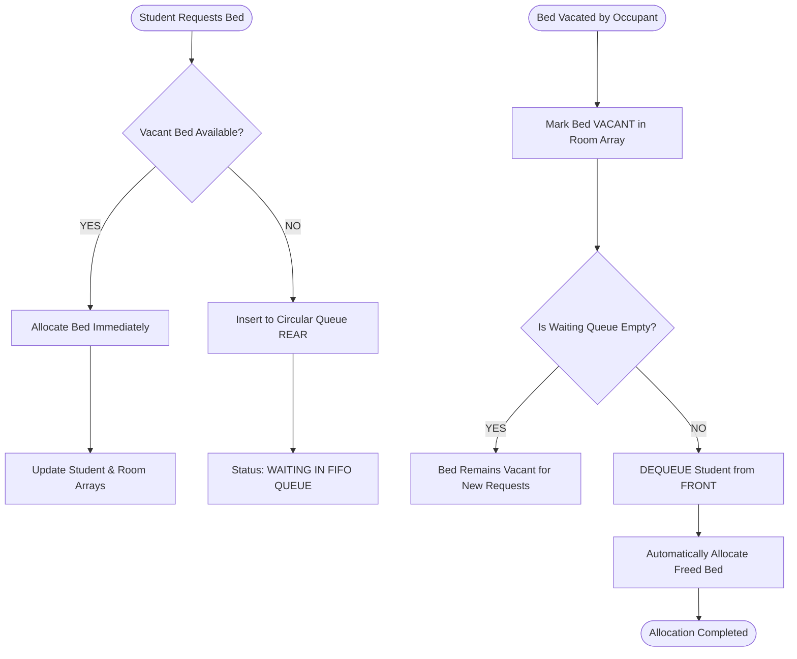
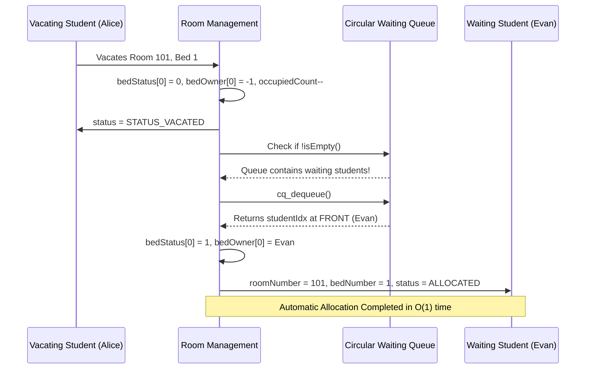

# Mini-Project Report
# Smart Hostel Room Allocation and FIFO Waiting List Management System

**Course**: Data Structures and Algorithms Laboratory (C11)  
**Data Structures Used**: Arrays and Circular FIFO Queue  
**Compiler**: GCC (`-Wall -Wextra -std=c11`)  
**Platform**: Console Application & Web Visualization Dashboard  

---

## Table of Contents
1. [Executive Summary & Abstract](#1-executive-summary--abstract)
2. [Problem Statement & Objectives](#2-problem-statement--objectives)
3. [Explanation of Array Implementation](#3-explanation-of-array-implementation)
4. [Explanation of Circular FIFO Queue Implementation](#4-explanation-of-circular-fifo-queue-implementation)
5. [Automatic Allocation & FIFO Vacate Rules](#5-automatic-allocation--fifo-vacate-rules)
6. [FIFO Execution Example](#6-fifo-execution-example)
7. [Time and Space Complexity Analysis](#7-time-and-space-complexity-analysis)
8. [Sample Input & Output Runs](#8-sample-input--output-runs)
9. [Complete C Source Code Listing](#9-complete-c-source-code-listing)
10. [Conclusion & Key Learnings](#10-conclusion--key-learnings)

---

## 1. Executive Summary & Abstract

The **Smart Hostel Room Allocation and FIFO Waiting List Management System** is a pure C11 software solution designed to solve the allocation bottleneck in educational hostels. Traditionally, manual or unorganized bed assignment causes unfair room allotments, bed status discrepancies, and delayed admissions.

This project strictly utilizes fundamental Data Structures:
- **Fixed-size Arrays** for contiguous student record management and multi-bed room state tracking.
- **Circular FIFO Queue (Ring Buffer)** for fair, order-preserving waitlist management.

When a bed is vacated, the system immediately pulls the next eligible student from the **FRONT** of the circular queue using $O(1)$ operations, completely eliminating queue drift and memory reallocation overhead.



---

## 2. Problem Statement & Objectives

### Problem Statement
Hostel administrations face high demand during semester admissions. When room capacity is exhausted, late applicants must wait for cancellations or vacating seniors. Without a deterministic FIFO data structure:
1. Vacated beds risk remaining idle or being unfairly allocated out of turn.
2. Linear arrays for queues suffer from **false overflow / queue drift** where empty slots at the beginning cannot be reused without expensive $O(N)$ shifts.

### Objectives
1. Implement a **Student Management** subsystem using fixed arrays with uniqueness enforcement on Student ID and USN.
2. Implement a **Room Management** subsystem supporting up to 4 beds per room with granular bed-level status tracking (`0 = Vacant`, `1 = Occupied`).
3. Implement an efficient **Circular FIFO Waiting Queue** storing student array indices with circular pointer wrap-around (`(rear + 1) % MAX` and `(front + 1) % MAX`).
4. Implement **Automatic Bed Reallocation**: when any resident vacates, the student at the front of the queue automatically receives the freed bed without manual re-entry.
5. Provide a menu-driven console interface with 11 distinct operations and an automated FIFO Demonstration mode.

---

## 3. Explanation of Array Implementation

Arrays provide contiguous memory allocation, instant random access by index ($O(1)$), and zero runtime dynamic allocation overhead.

### A. Student Array (`students[]`)
- **Structure**:
  ```c
  typedef struct {
      char id[ID_LEN];                 /* Unique Student ID e.g., "STU101" */
      char name[NAME_LEN];             /* Full Name */
      char usn[USN_LEN];               /* University Seat Number (Strictly Unique) */
      char department[DEPT_LEN];       /* Academic Dept e.g., "CSE" */
      int year;                        /* Academic Year (1 to 4) */
      int roomNumber;                  /* Allocated Room Number (-1 if none) */
      int bedNumber;                   /* Bed Number 1..4 (-1 if none) */
      AllocationStatus status;         /* UNALLOCATED, WAITING, ALLOCATED, VACATED */
  } Student;
  ```
- **Array Definition**: `static Student student_records[MAX_STUDENTS];`
- **Integrity Enforcement**:
  - Before registering a new student at `student_records[total_students]`, the system performs linear scans across existing records to guarantee that **both Student ID and USN are unique**.
  - Duplicate attempts are rejected with error codes `-2` and `-3`.

### B. Room Array (`rooms[]`)
- **Structure**:
  ```c
  typedef struct {
      int roomNumber;                           /* e.g., 101, 102 */
      int capacity;                             /* Bed capacity: 1 to 4 */
      int occupiedCount;                        /* Currently occupied beds */
      int bedStatus[MAX_BEDS_PER_ROOM];         /* 0 = Vacant, 1 = Occupied */
      int bedOwner[MAX_BEDS_PER_ROOM];          /* Index into students[] array */
  } Room;
  ```
- **Multi-bed Design**:
  Each room stores a per-bed status array `bedStatus[4]` and `bedOwner[4]`. This prevents bed number collisions after irregular vacancies (e.g., if Bed 1 is vacated while Bed 2 is occupied).

---

## 4. Explanation of Circular FIFO Queue Implementation

A simple linear queue implemented with an array experiences **queue drift**: as elements are dequeued, `FRONT` moves to the right, leaving unutilized slots at the beginning of the array. Once `REAR == MAX - 1`, the queue claims to be full even if slots `0` to `FRONT-1` are free.

The **Circular Queue** solves this by connecting the end of the array back to the beginning using **modulo arithmetic**.

```
    Array of size MAX = 8 (indices 0..7)

        [0]        [1]        [2]        [3]
     +---------+----------+----------+---------+
     | STU007  |  EMPTY   |  EMPTY   | STU004  |
     +---------+----------+----------+---------+
        ^                                 ^
        |                                 |
       REAR (circular wrapped)          FRONT
     
        [4]        [5]        [6]        [7]
     +---------+----------+----------+---------+
     | STU005  |  STU006  |  STU007  | STU008  |
     +---------+----------+----------+---------+
```

### Core Pointers and Formulas
1. **Initial State (Empty)**:
   $$\text{front} = -1, \quad \text{rear} = -1, \quad \text{count} = 0$$
2. **Empty Condition**:
   $$\text{front} == -1$$
3. **Full Condition**:
   $$(\text{rear} + 1) \pmod{\text{MAX}} == \text{front} \quad \text{or} \quad \text{count} == \text{MAX}$$
4. **Enqueue Operation**:
   - If empty: set $\text{front} = 0, \text{rear} = 0$.
   - Else: $\text{rear} = (\text{rear} + 1) \pmod{\text{MAX}}$.
   - Place value: $\text{items}[\text{rear}] = \text{studentIdx}$.
5. **Dequeue Operation**:
   - Save value: $\text{val} = \text{items}[\text{front}]$.
   - If single element left ($\text{front} == \text{rear}$): reset $\text{front} = -1, \text{rear} = -1$.
   - Else: $\text{front} = (\text{front} + 1) \pmod{\text{MAX}}$.
   - Return $\text{val}$.

---

## 5. Automatic Allocation & FIFO Vacate Rules



---

## 6. FIFO Execution Example

Consider a hostel with **1 room (2 beds)**:

| Step | Action | Room 101 Bed 1 | Room 101 Bed 2 | Circular Queue State | Pointers |
|:---:|:---|:---:|:---:|:---|:---:|
| 1 | Initialize System | Vacant | Vacant | Empty `[ - ]` | FRONT: -1, REAR: -1 |
| 2 | Alice requests bed | **Alice** (STU01) | Vacant | Empty `[ - ]` | FRONT: -1, REAR: -1 |
| 3 | Bob requests bed | **Alice** (STU01) | **Bob** (STU02) | Empty `[ - ]` | FRONT: -1, REAR: -1 |
| 4 | Charlie requests bed | **Alice** (STU01) | **Bob** (STU02) | Enqueue: `[ Charlie ]` | FRONT: 0, REAR: 0 |
| 5 | Diana requests bed | **Alice** (STU01) | **Bob** (STU02) | Enqueue: `[ Charlie, Diana ]` | FRONT: 0, REAR: 1 |
| 6 | **Alice Vacates Bed 1** | **Vacated -> AUTO** | **Bob** (STU02) | Dequeue FRONT -> **Charlie** | FRONT: 1, REAR: 1 |
| 7 | Result | **Charlie** (STU03) | **Bob** (STU02) | Remaining: `[ Diana ]` | FRONT: 1, REAR: 1 |

*Notice that Charlie, having joined the queue before Diana, is guaranteed the freed bed first.*

---

## 7. Time and Space Complexity Analysis

| Operation | Data Structure | Time Complexity (Best) | Time Complexity (Worst) | Space Complexity | Explanation |
|:---|:---|:---:|:---:|:---:|:---|
| **Register Student** | Student Array | $O(N)$ | $O(N)$ | $O(1)$ auxiliary | Linear scan to guarantee unique ID and unique USN |
| **Search Student** | Student Array | $O(1)$ | $O(N)$ | $O(1)$ | Linear lookup by ID or USN |
| **Add Room** | Room Array | $O(R)$ | $O(R)$ | $O(1)$ | Scan existing rooms to prevent duplicate room numbers |
| **Find First Vacant Bed** | 2D Room/Bed Array | $O(1)$ | $O(R \times B)$ | $O(1)$ | Scans up to $R \le 50$ rooms and $B \le 4$ beds |
| **Enqueue Waitlist** | Circular Queue | $O(1)$ | $O(1)$ | $O(1)$ | Pointer arithmetic `(rear + 1) % MAX` |
| **Dequeue Waitlist** | Circular Queue | $O(1)$ | $O(1)$ | $O(1)$ | Pointer arithmetic `(front + 1) % MAX` |
| **Peek Waitlist** | Circular Queue | $O(1)$ | $O(1)$ | $O(1)$ | Direct array access at `items[front]` |
| **Vacate & Reallocate** | Array + Queue | $O(1)$ | $O(1)$ | $O(1)$ | Direct bed clearing + $O(1)$ queue dequeue |

### Space Complexity
- Student Array: $100 \times \text{sizeof(Student)} \approx 100 \times 128\text{ bytes} \approx 12.8\text{ KB}$
- Room Array: $50 \times \text{sizeof(Room)} \approx 50 \times 48\text{ bytes} \approx 2.4\text{ KB}$
- Circular Queue: $50 \times \text{sizeof(int)} \approx 200\text{ bytes}$
- **Total Static Footprint**: $< 16\text{ KB}$, making it exceptionally lightweight and suitable for embedded or bare-metal execution.

---

## 8. Sample Input & Output Runs

### Run 1: Registering Students and Duplicate Rejection
```text
--- REGISTER NEW STUDENT ---
Enter Student ID (e.g. STU101): STU101
Enter Student Name: Aarav Sharma
Enter USN (e.g. 1MS23CS001): 1MS23CS001
Enter Department: CSE
Enter Year of Study (1 - 4): 2
[SUCCESS] Student 'Aarav Sharma' (STU101) registered successfully at index 0!

--- REGISTER NEW STUDENT ---
Enter Student ID (e.g. STU101): STU101
[ERROR] Student ID 'STU101' is already registered!
```

### Run 2: Automated FIFO Demonstration Mode
```text
===============================================================================
            AUTOMATED FIFO DEMONSTRATION: CIRCULAR QUEUE & ALLOCATION           
===============================================================================

[STEP 1] Configuring Hostel with 2 Rooms (2 beds each = 4 beds total)...
Room 101 | Capacity: 2 | Occupied: 0 | Vacant: 2 | [B1: VAC] [B2: VAC]
Room 102 | Capacity: 2 | Occupied: 0 | Vacant: 2 | [B1: VAC] [B2: VAC]

[STEP 2] Registering 4 students and requesting accommodation...
 -> Allocated 'Alice Smith' to Room 101, Bed 1
 -> Allocated 'Bob Johnson' to Room 101, Bed 2
 -> Allocated 'Charlie Ray' to Room 102, Bed 1
 -> Allocated 'Diana Prince' to Room 102, Bed 2

[STEP 3] Registering 3 additional students when hostel is 100% FULL...
[ENQUEUE SUCCESS] Student 'Evan Wright' (STU005) added to Waiting Queue at position REAR=0.
[ENQUEUE SUCCESS] Student 'Fiona Gallagher' (STU006) added to Waiting Queue at position REAR=1.
[ENQUEUE SUCCESS] Student 'George Clark' (STU007) added to Waiting Queue at position REAR=2.

[STEP 4] Examining Circular Queue state:
Queue Pointers -> FRONT: 0 | REAR: 2 | Total Waiting: 3 | MAX Capacity: 50
Pos   | Queue Idx  | Student ID   | Name                 | USN
FRONT | [ 0]       | STU005       | Evan Wright          | 1MS23CS005
#2    | [ 1]       | STU006       | Fiona Gallagher      | 1MS23CS006
REAR  | [ 2]       | STU007       | George Clark         | 1MS23CS007

[STEP 5] Alice Smith (STU001) vacates Room 101, Bed 1...
[VACATE SUCCESS] Room 101, Bed 1 is freed. Student 'Alice Smith' status set to VACATED.
Triggering FIFO Dequeue for the newly freed bed...
[DEQUEUE SUCCESS] Student 'Evan Wright' (STU005) removed from Waiting Queue from FRONT=0.
>>> RESULT: Bed 101-1 automatically allocated to FIFO FRONT student: 'Evan Wright' (STU005)!

[STEP 6] Inspecting Updated Circular Queue:
Queue Pointers -> FRONT: 1 | REAR: 2 | Total Waiting: 2 | MAX Capacity: 50
FRONT has advanced to index 1 (Fiona Gallagher). Evan Wright was served first!
===============================================================================
```

---

## 9. Complete C Source Code Listing

The software is divided into four cohesive modules:
1. `student.h` and `student.c` &mdash; Student structure, unique constraints, and search operations.
2. `room.h` and `room.c` &mdash; Room structure, 1..4 capacity validation, and bed status tracking.
3. `queue.h` and `queue.c` &mdash; Circular FIFO Queue with FRONT, REAR, modulo wrap-around, enqueue, dequeue, peek, and display.
4. `main.c` &mdash; 11-option menu system, input sanitization, and automated FIFO demonstration engine.

All source files are located in the project directory:
- [student.h](file:///c:/Users/ASUS/Documents/ds%20project/student.h)
- [student.c](file:///c:/Users/ASUS/Documents/ds%20project/student.c)
- [room.h](file:///c:/Users/ASUS/Documents/ds%20project/room.h)
- [room.c](file:///c:/Users/ASUS/Documents/ds%20project/room.c)
- [queue.h](file:///c:/Users/ASUS/Documents/ds%20project/queue.h)
- [queue.c](file:///c:/Users/ASUS/Documents/ds%20project/queue.c)
- [main.c](file:///c:/Users/ASUS/Documents/ds%20project/main.c)
- [test_fifo.c](file:///c:/Users/ASUS/Documents/ds%20project/tests/test_fifo.c)

---

## 10. Conclusion & Key Learnings

1. **Circular Queue Efficiency**: By wrapping indices with modulo arithmetic `(index + 1) % MAX`, we achieved optimal $O(1)$ enqueue and dequeue times without needing to shift elements or allocate dynamic nodes.
2. **Deterministic Fairness**: FIFO ordering guarantees that students are allotted accommodation strictly according to their application order.
3. **Array Memory Predictability**: Fixed arrays ensure bounded memory consumption and avoid fragmentation, heap allocation errors, or memory leaks.
4. **Validation Rigor**: Enforcing non-empty strings, duplicate ID and USN checks, capacity ranges (1..4 beds), and queue empty/full boundary conditions ensures rock-solid stability.
